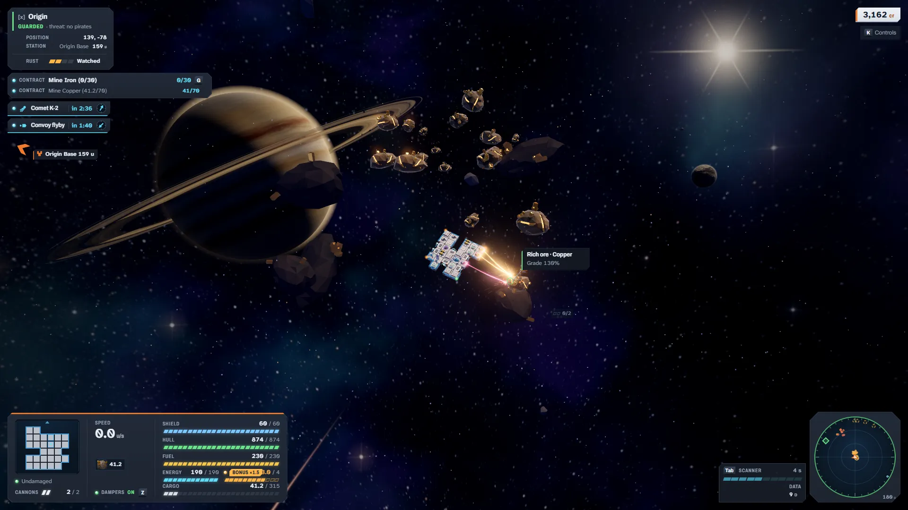
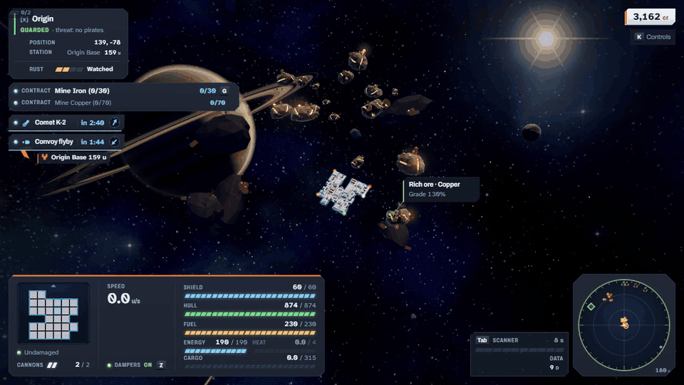
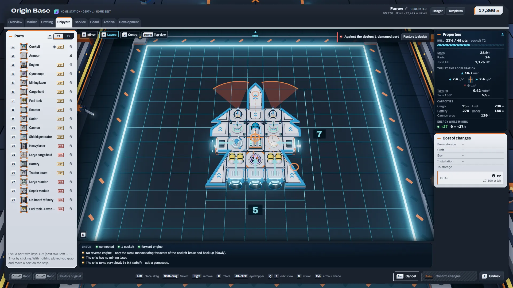
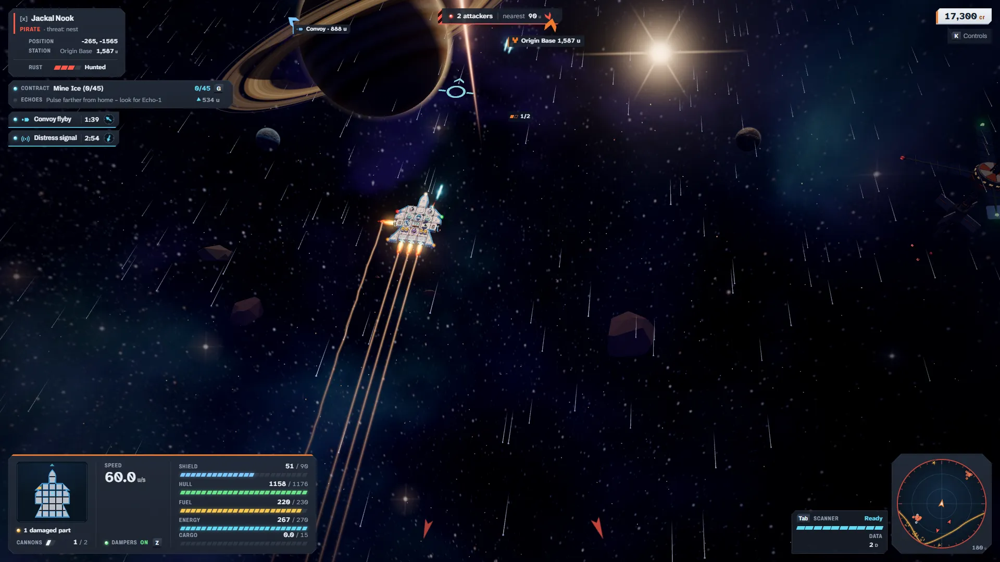
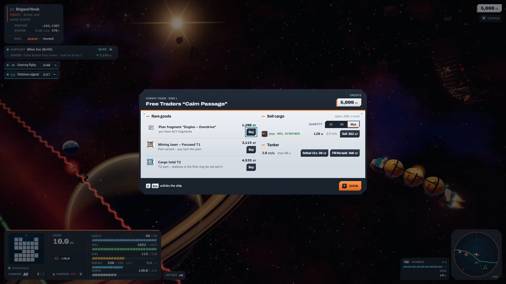
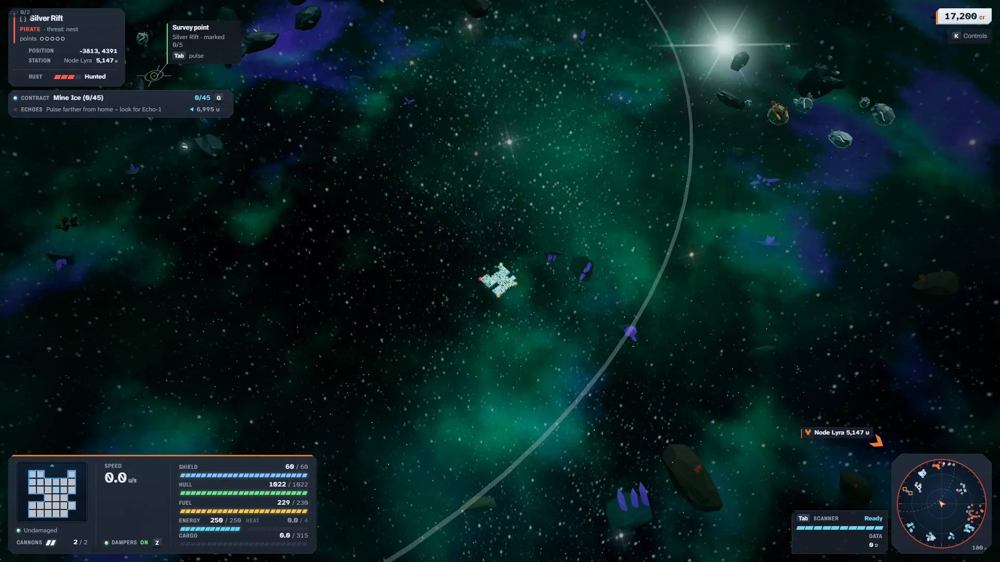
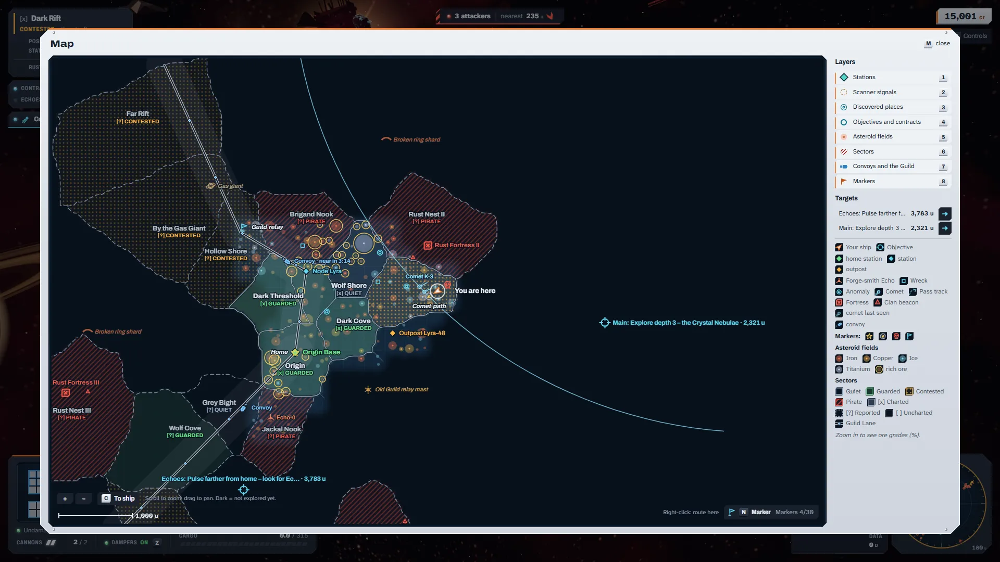
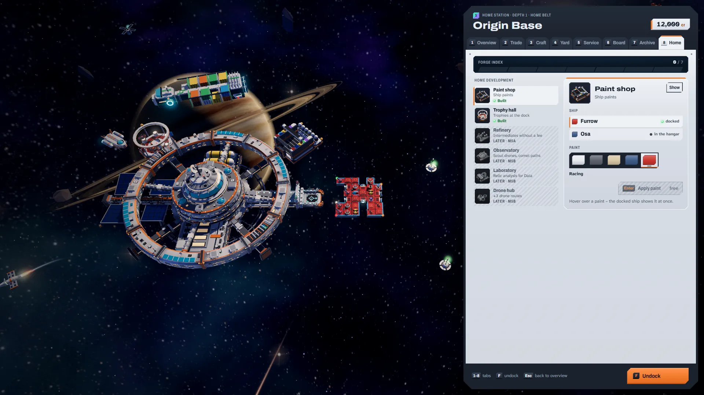

# Cinderbelt

**Build your own ship from parts, then fly it somewhere worth going.**



## [▶ Play in your browser](https://amoreo140.github.io/cinderbelt/)

Cinderbelt is a top-down 3D space game that runs in the browser. You mine asteroids, trade, and assemble your ship from parts on a grid. The ship is simulated as one rigid body, so where you put an engine or a cargo hold changes how it flies. You then explore an endless, sectorised universe and fight the Rust pirates, who fly ships built from parts just like yours. The game is available in English and Slovak.



## Features

- **Inertial flight.** Engines, gyroscopes and inertial dampers; ship mass, centre of gravity and moment of inertia come from the parts you placed.
- **Shipyard grid editor.** 1x1, 2x1 and 2x2 parts, a hull budget per cockpit tier, nine armour shapes, mirror mode, templates and `AF1.`/`AF2.` share codes.
- **Mining as a skill.** Aim the laser at veins of varying grade; lasers overheat, so careful flying pays.
- **Infinite deterministic universe.** Space is generated from a seed in 200x200 chunks; only your changes are saved. Irregular named sectors have a security level (Quiet, Guarded, Contested, Pirate), their own environment, sky and music.
- **Economy.** Fuel from ice, energy from reactors, cargo mass, tiered crafting, a market, and contracts (delivery, mining, hunt, rescue, survey, escort, fortress and more).
- **Guild convoys and Watch patrols.** Link up with trade convoys to trade or refuel, take escort contracts, restore Guild relays to make a sector Guarded.
- **Part-based combat.** Shots hit the part they reach, shields absorb first, severed sections become separate wrecks; tow wrecks with the tractor beam and salvage them.
- **Pirate clans and Rust Fortresses.** Clans with their own ship models, named captains with bounties, and fortresses as early milestones.
- **Exploration.** Scanner, signals, comets you can mine in motion, derelict stations, ship graveyards, a journal, and a sector map with your own notes and chart sales.
- **Progression without XP.** The Archive research tree unlocks parts and services; a home station with paint shop and trophy hall; a hangar for several ships.
- **Four death penalties** (None, Mild, Hard, Hardcore) and separate difficulty settings.
- **Original assets.** Models come from Blender scripts and the adaptive music is composed as code; nothing is downloaded.

## Screenshots

<table>
<tr>
<td><br><sub>Shipyard: a fighter with shaped armour</sub></td>
<td><br><sub>Combat against a pirate pair in a Rust sector</sub></td>
</tr>
<tr>
<td><br><sub>Trading with a Guild convoy</sub></td>
<td><br><sub>The edge of a ship graveyard</sub></td>
</tr>
<tr>
<td><br><sub>Sector map with layers and markers</sub></td>
<td><br><sub>Home station: paint shop and trophy hall</sub></td>
</tr>
</table>

## Controls

| Key | Action |
|---|---|
| W / S | Thrust forward / back |
| A / D | Turn |
| Q / E | Strafe |
| Mouse + left button | Cannons |
| Mouse + right button | Mining laser |
| Z | Inertial dampers on / off |
| F | Dock / undock / salvage |
| Tab | Scanner: tap to pulse, hold to analyse |
| T | Tractor beam: grab / release |
| Y / X | Pay / refuse a pirate toll |
| M | Map |
| J | Journal |
| L | Radio log (recent messages) |
| G | Objectives |
| I | Storage |
| N | Sound on / off |
| H | Tow (when out of fuel) |
| Mouse wheel | Zoom |
| F5 | Save game |
| Esc | Pause |
| K | Show / hide the controls help |

In the shipyard, K shows the editor help (R rotate, M mirror, C centre the view, Home top view).

## Status

Early but playable, and under active development. Saves live in your browser (IndexedDB); you can export a save to an `.cinder` file from the game. Saves are versioned and older ones migrate automatically. Plans for the future are in the [roadmap](docs/GAME-DESIGN.md#8-roadmap-plans-not-promises); the full design overview is in [docs/GAME-DESIGN.md](docs/GAME-DESIGN.md).

## Made with AI

The author designs the game and makes the decisions. The code, the Blender-script art and the code-composed music are written by AI coding agents (Claude Code) working under the author's direction. Automated tests, a balance bot and performance budgets act as guard rails. The details of the process are in [docs/MADE-WITH-AI.md](docs/MADE-WITH-AI.md).

## Run locally

You need Node.js (developed on Node 24) and npm.

```text
npm install
npm run dev        # http://localhost:5317
npm run build      # typecheck + production build
npm test           # unit tests
npm run test:e2e   # Playwright end-to-end tests
npm run lint:lang  # English-code check
```

See [CONTRIBUTING.md](CONTRIBUTING.md) and [docs/ARCHITECTURE.md](docs/ARCHITECTURE.md) for the project rules and the code structure. The repository is at <https://github.com/amoreo140/cinderbelt>.

## License

- Code: MIT, see [LICENSE](LICENSE).
- Art and music (models, textures, icons, music): CC BY 4.0, see [LICENSE-ASSETS.md](LICENSE-ASSETS.md).
- Bundled fonts: SIL Open Font License 1.1, see [THIRD-PARTY.md](THIRD-PARTY.md).
